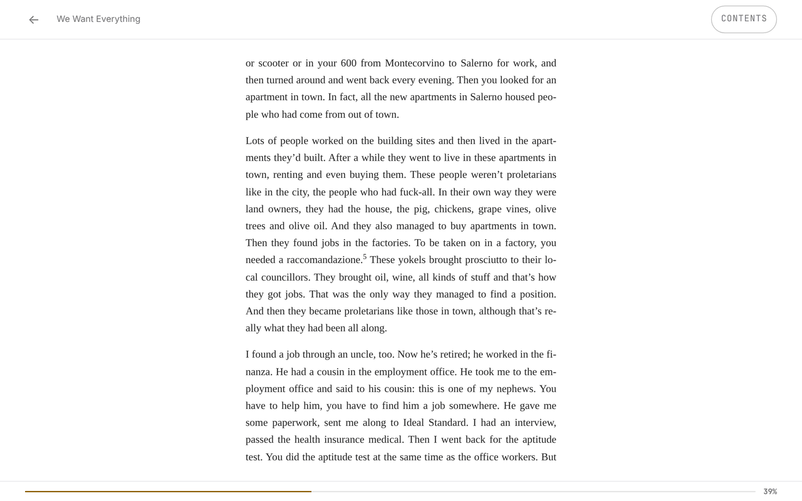
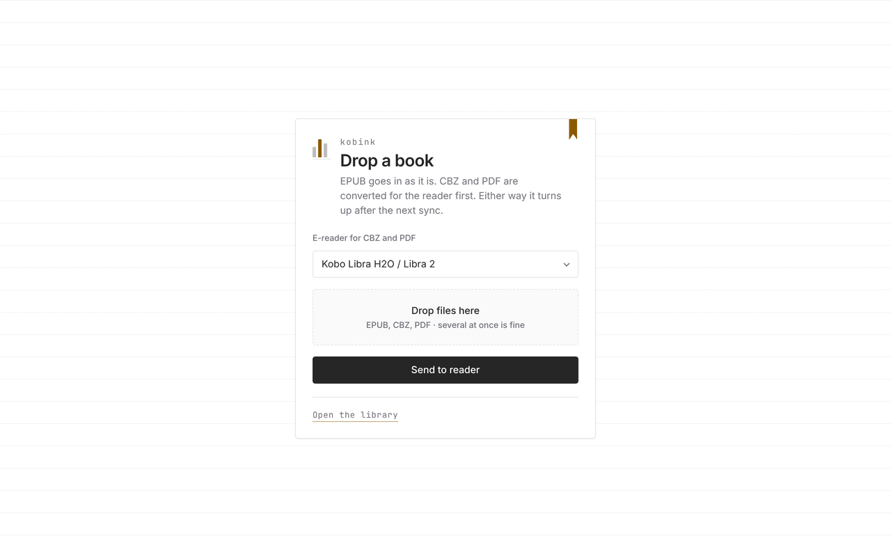

# Kobink

A Kobo can only download books from the Kobo store. Kobink runs on your own machine, answers at
that address instead, and hands out the files you already have. The books stay in a folder.
Nothing gets uploaded.

## Screenshots

| The library is the root | A book in the browser |
| --- | --- |
|  |  |
|  |  |

## How it works

The reader asks its store what it owns. Kobink replies with your folder, so for the Kobo it looks
like a normal sync. The address you type into the device carries a secret code, and without it
nothing is found. That is the whole access control, so forward a public URL only if the
link stays with you. The code is printed at startup:

```bash
docker compose logs kobink | grep -A2 "api key"
```

## Setup

```yaml
services:
  kobink:
    image: ghcr.io/tswh0/kobink:latest
    restart: unless-stopped
    ports: ["3000:3000"]
    environment:
      PUBLIC_URL: http://192.168.1.10:3000
    volumes:
      - /path/to/books:/library:ro
      - ./data:/app/data
```

`PUBLIC_URL` must be an address the reader can reach. The bundled `docker-compose.yml` runs
unprivileged with a read-only root; `chown -R 1000:1000 ./data` once.

On the Kobo, in `.kobo/Kobo/Kobo eReader.conf`:

```ini
[OneStoreServices]
api_endpoint=http://192.168.1.10:3000/PASTE-YOUR-KEY-HERE/kobo
```

Replace the placeholder with the code from the log; the path ends at `/kobo`, the device appends
`/v1`. Press Sync afterwards.

## What it does

- Covers are cut from each book by the server, in the sizes the device asks for.
- Volumes arrive as a series with the right numbering, from metadata or the title.
- A sync with nothing new costs a few kilobytes.
- `/drop` takes EPUB, CBZ and PDF, several at once. CBZ and PDF go through
  [KCC](https://github.com/ciromattia/kcc), which needs `LIBRARY_WRITE=:rw` and the `:conversion`
  image (~400 MB); plain `latest` takes EPUB only.
- Deleting a book on the reader moves its file into `.kobink-trash/`, or removes it outright with
  `LIBRARY_TRASH=off`.
- Downloads stream and answer `Range`; an interrupted transfer resumes.
- The folder is rescanned every ten minutes; drop a file in, wait, sync.
- No database. One container, two folders.

## Reading in the browser

The library is the domain root, behind the same key: a shelf of covers, a paginated view for EPUBs
and a page-flip view for fixed-layout kepubs. It complements the Kobo, it does not replace it. Where
you stop on the device is where the browser opens, and a page turned in the browser reaches the
device at its next sync. No highlights, notes, dictionary or library management: no full web
reader, just somewhere to read while the device is on the shelf.

Installable to a phone home screen, with an offline page when the server is down. Progress is one
JSON per book in `.kobink-progress/`, and goes with the book.

## Compared to upstream

Forked from [potatoeggy/kobink](https://github.com/potatoeggy/kobink), which does the protocol and
stops there: anyone who can reach the port can download the library, and the tree does not build.

This fork puts the key in the path, builds in Docker, renders covers, marks KCC books as fixed
layout, and tests the real binary on every push.

## Notes

- HTTP on your LAN is fine. Behind a reverse proxy use HTTPS and keep the link to yourself.
- `.epub` for books, `.kepub.epub` (KCC) for manga; a CBZ is counted in the scan but never synced.
- `COVER_CACHE_DAYS` and `TRASH_DAYS` (default 30, `0` keeps forever) prune the cover cache and
  `.kobink-trash`; `API_KEY` picks the code instead of the generated one.
- Distroless, so no shell: `docker logs kobink`; `--version` and `--health` still answer via
  `docker exec`.

License: AGPL-3.0, like the original.
